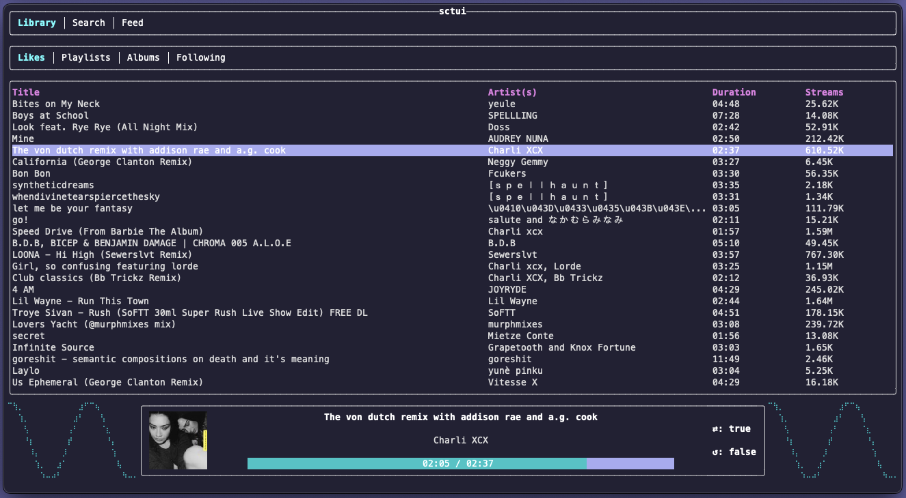
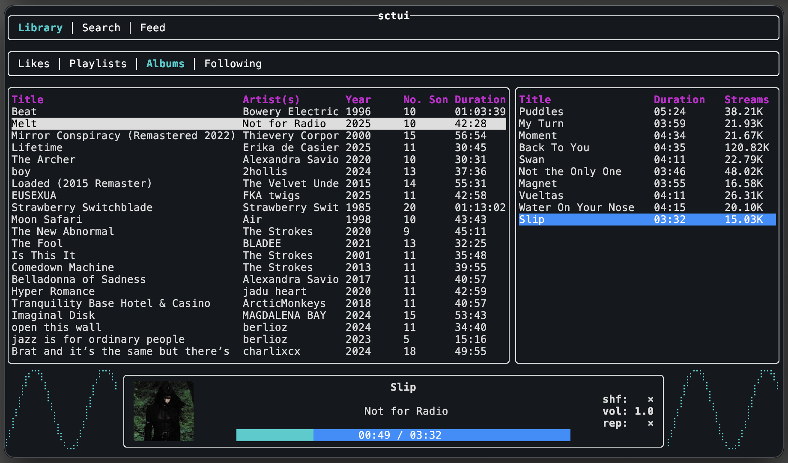
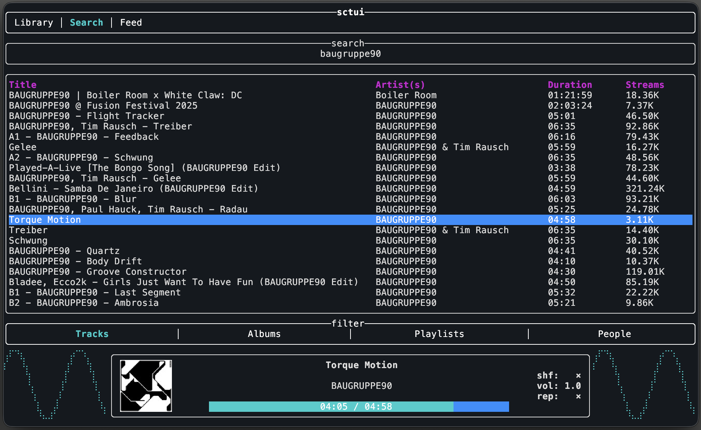
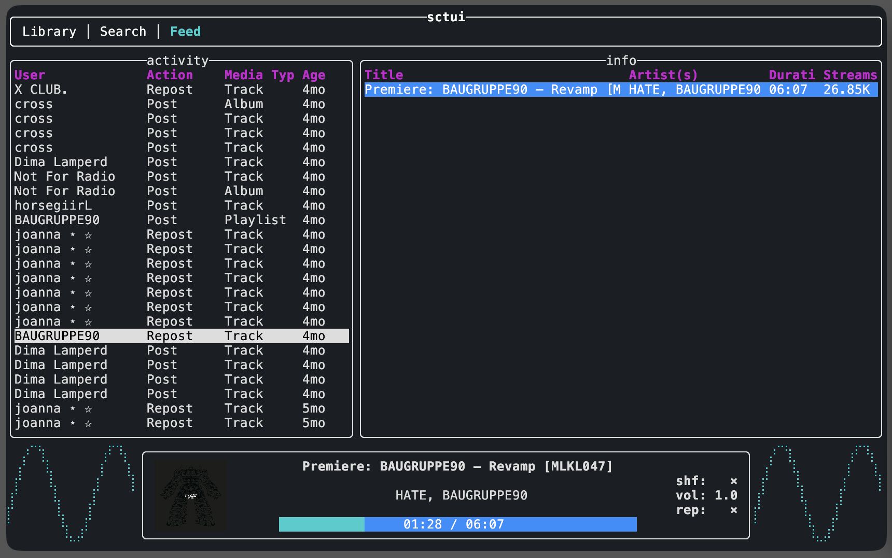
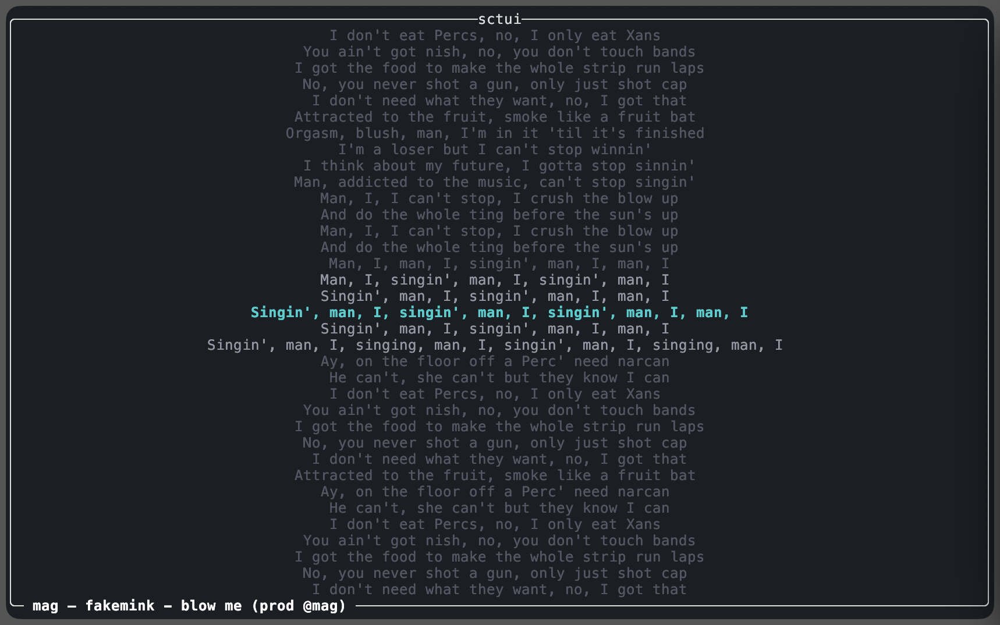
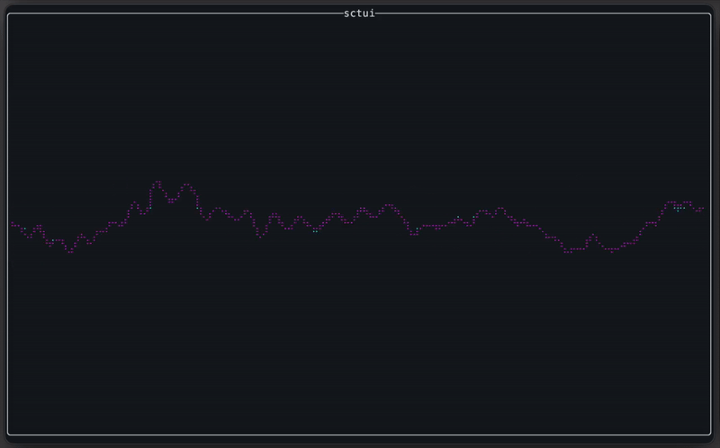
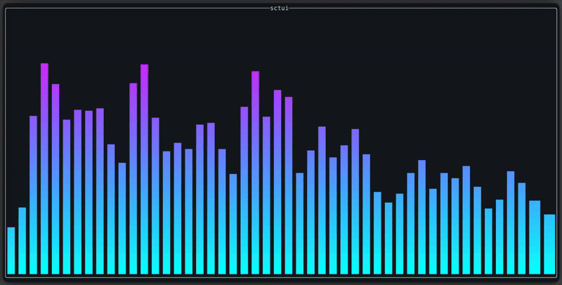

# sctui

a soundcloud client for the terminal



## Installation

<details>
<summary><b>Instructions</b></summary>

### macOS / Linux

```sh
curl -fsSL https://raw.githubusercontent.com/Illogicalll/sctui/main/install.sh | sh
```

### Windows

```powershell
irm https://raw.githubusercontent.com/Illogicalll/sctui/main/install.ps1 | iex
```

### Manual download

Grab the archive for your platform from the [latest release](https://github.com/Illogicalll/sctui/releases/latest), extract it and put `sctui` somewhere on your `PATH`.

### From source

Needs [Rust](https://rustup.rs) 1.85+. On Linux, install the ALSA headers first: `sudo apt install libasound2-dev pkg-config`

```sh
cargo install --git https://github.com/Illogicalll/sctui
```

</details>

<details>
<summary><b>Updating</b></summary>

sctui checks GitHub for a newer release every time it starts and asks before installing it. Pass `--no-update-check` to skip the check, or re-run the installer above to update by hand. `sctui --version` shows what you have.

</details>

<details>
<summary><b>Requirements</b></summary>

- **A SoundCloud account.** The free tier is fine.
- **A modern terminal with true colour.** Cover art needs a terminal that supports an image protocol.
- **A font with Unicode block and braille glyphs** for the visualisers. Any Nerd Font, JetBrains Mono or Fira Code works.
- **Linux:** the ALSA runtime (`libasound2`), which every desktop distro ships. PipeWire and PulseAudio work through their ALSA plugin.
- **macOS 11+** or **Windows 10+**.

</details>

## Features

### 🎧 High Quality Ad-Free playback

<p align="center">Stream tracks directly from SoundCloud without the interruptions you would usually experience with a free account on the website</p>

### ✅ Fully Featured

<p align="center">Browse your own Likes, Playlists and Saved Albums as well as the Tracks and Likes of the People you follow</p>

<p align="center"></p>

<p align="center">Search for Tracks, Albums and Playlists to add to your library, as well as new People to follow</p>

<p align="center"></p>

<p align="center">View the activity of everyone you follow to stay up to date with their latest releases or reposts</p>

<p align="center"></p>

### 🔊 Gapless Playback

<p align="center">Enjoy seamless transitions in your favourite albums without the buffering present on SoundCloud Web</p>

### 📻 Stations

<p align="center">When a playlist, album or your likes run out, sctui keeps going with related tracks. Alternatively, pressing `S` (or Shift + Enter) on any track or artist will start a queue of related tracks</p>

### 🎛️ Native Media Integration

<p align="center">The current track shows in your system's media panel with artwork and a live position. The play/pause/ skip buttons on your keyboard, headphones integrate directly</p>

### 🎤 Lyrics

<p align="center">Where available, live lyrics can be displayed in the visualiser (sourced from <a href="https://lrclib.net">LRCLIB</a>)</p>

<p align="center"></p>

### 👁️ Audio Visualiser

<p align="center">Choose from one of 14 modes, from oscilloscopes to spectrums and more...</p>

<p align="center"></p>

<p align="center"></p>

<p align="center">+ 12 more...</p>

## Using sctui

> **Upgrading from an earlier version:** the default keys changed for almost every action (they now follow vim / tmux habits, see the table below). Your own `[keys]` overrides are matched by action name and keep working. Overrides for the four actions that no longer exist (`secondary_up`, `secondary_down`, `tertiary_up`, `tertiary_down`) are ignored, with a warning at startup that names them: panes are now focused with `[` and `]` instead. The first launch asks once whether you want a two-minute tour of the new keys.

<details>
<summary><b>First run</b></summary>

The first time sctui starts (after the browser login) a short setup wizard runs: choose a layout, choose a theme (both previewed live on your own library), then a ten-step tour of the important keys. Each step completes when you actually do the thing, whichever key you have it bound to. The tour only moves, plays, queues and filters; nothing in it changes your SoundCloud account. `Esc` skips it at any point.

Run it again any time with `sctui --setup`, or `Setup wizard` in the command palette.

</details>

<details>
<summary><b>Layouts</b></summary>

Five layouts over the same panes, keys and player. Pick one in the wizard, on the Settings page of the `?` popup, or from the command palette (`Layout: sidebar`, ...). The choice is saved.

| Layout | What it looks like |
|---|---|
| `classic` | The original look: boxed tabs and sub-tabs, 7-row player bar with the sine wave |
| `tighten` | Two header rows, then as many list rows as fit, and a 4-row player bar |
| `sidebar` | Library sections and your playlists in a column on the left; optional docked queue on wide terminals |
| `columns` | Miller columns with a breadcrumb: `[` steps out, `]` or `Enter` steps in; a track card on very wide terminals |
| `player-panel` | Lists on the left, a permanent player on the right that pages between Up next, Lyrics, Spectrum and History (`o`) |

Every layout adapts to the terminal: panes drop from three to two to one as the width shrinks (reach the hidden ones with `[` `]`), track columns drop, the player bar shrinks to one line, and below 36×8 sctui just says the terminal is too small. Existing installs stay on `classic` until you change it; new installs that skip the wizard get `tighten`.

</details>

<details>
<summary><b>Keys</b></summary>

One pane has focus (accent border). Movement and every action on a selection (play, queue, like, add to playlist, remove, station) act on the focused pane's selected row. Deleting, liking or following a playlist, album or person needs that row focused, not one of its tracks.

| Group | Keys | Action | Config name |
|---|---|---|---|
| Move | `j` `k`, `Down` `Up` | Move in the focused pane | `down`, `up` |
| | `[` `]` | Focus the pane to the left / right | `pane_left`, `pane_right` |
| | `g g`, `Home` | First row | `top` |
| | `G`, `End` | Last row | `bottom` |
| | `Ctrl+D` / `Ctrl+U` | Half a page down / up | `half_page_down`, `half_page_up` |
| | `Ctrl+F`, `PageDown` / `Ctrl+B`, `PageUp` | A page down / up | `page_down`, `page_up` |
| Views | `h` `l`, `Left` `Right` | Previous / next sub-tab or search type (wraps) | `sub_tab_left`, `sub_tab_right` |
| | `1` `2` `3` | Library / Search / Feed | `tab_library`, `tab_search`, `tab_feed` |
| | `Tab` / `Shift+Tab` | Next / previous main tab | `next_tab`, `prev_tab` |
| Find | `/` | Filter the list (Library) or type a search (Search) | `search` |
| | `:`, `Ctrl+P` | Command palette | `palette` |
| | `?` | Keys, settings and equaliser | `help` |
| Playback | `Enter` | Play the selected track / step into the selected playlist, album, person or feed item | `play_selected` |
| | `Space` | Play / pause | `play_pause` |
| | `>` `<` | Next / previous track | `next_track`, `prev_track` |
| | `.` `,` | Seek forward / back 10 s | `seek_forward`, `seek_backward` |
| | `+` `=` / `-` | Volume up / down | `volume_up`, `volume_down` |
| | `s` / `r` | Shuffle / repeat | `toggle_shuffle`, `toggle_repeat` |
| | `S`, `Shift+Enter` | Start a station from the selected track or artist | `start_station` |
| Track | `a` / `A` | Add to queue / play next | `add_to_queue`, `play_next` |
| | `f` / `F` | Like or unlike (follow or unfollow) the selection / the playing track | `toggle_like`, `toggle_like_playing` |
| | `p` / `P` | Add the selection / the playing track to a playlist | `add_to_playlist`, `add_to_playlist_playing` |
| | `d` | Remove from your playlist (asks first) | `remove_from_playlist` |
| | `b` / `B` | Open the selection (track, playlist, album or person) / the playing track on soundcloud.com | `open_in_browser`, `open_in_browser_playing` |
| Playlist | `c` / `x` | New playlist / delete your playlist (asks first) | `new_playlist`, `delete_playlist` |
| Panels | `q` / `H` | Queue / history | `toggle_queue`, `toggle_history` |
| | `v` | Visualiser (`Tab` cycles its modes) | `toggle_visualizer` |
| | `t` | Theme picker | `themes` |
| | `o` | Next page of the player panel (`player-panel` layout) | `panel_page` |
| App | `Q` | Quit (asks first) | `quit` |
| | `Esc` | Close a popup / stop typing / clear the filter. Never quits | |

A capital letter means Shift. `Shift+Enter` needs a terminal with the kitty keyboard protocol; `S` works everywhere.

While you type (a filter, a search, the palette, a playlist name) every key types, capitals included: `Enter` confirms, `Esc` cancels, `Ctrl+W` deletes a word, `Ctrl+U` clears. Popups take every key until they are closed.

**Hint line.** The bottom row lists the keys that apply to whatever has focus, read from your own bindings, and shows a half-typed sequence (`g …`) at the right. Turn it off on the Settings page or with `Hint line: toggle` in the palette.

**Command palette.** `:` or `Ctrl+P` lists every action with its keys, plus one entry per layout and per theme, the hint line toggle, the SoundCloud credit style and the setup wizard. Type a few letters (`lay sb` finds `Layout: sidebar`), `Enter` runs the highlighted one.

**Notices.** Likes, queue additions, playlist edits, shuffle / repeat and failures show for a few seconds in the top-right corner, and the playing track is marked `▶` (`⏸` when paused) in every list.

</details>

<details>
<summary><b>Configuration</b></summary>

Configuration lives in `~/.config/sctui/config.toml` / `C:\Users\<you>\.config\sctui\config.toml`. `sctui --dump-config` prints a commented template with every default.

### Themes

Press `t` to pick a colour theme with a live preview: `default`, `tokyonight`, `catppuccin-mocha`, `dracula`, `gruvbox-dark`, `nord`, `solarized-dark`, `one-dark`, `rose-pine`.

### Settings

`?` then `Tab` opens the Settings page (layout, hint line, SoundCloud credit, docked queue, hiding unplayable tracks or the feed tab, crossfade); `Tab` again is the equaliser. In the file they are under `[settings]`:

```toml
[settings]
layout = "tighten"      # classic, tighten, sidebar, columns, player-panel
hint_line = true
soundcloud_credit = "text"   # text, or glyph (needs a Nerd Font)
dock_queue = false      # sidebar layout, 120+ columns: show the queue as a column
```

An unknown layout name falls back to `classic` with a warning at startup.

Everything sctui plays and lists comes from SoundCloud, and its API terms ask apps to say so. `soundcloud_credit = "text"` (the default) shows `via SoundCloud` on the player's border; `"glyph"` shows the SoundCloud mark (Nerd Font U+F1BE) beside `sctui` instead. Use the glyph only with a Nerd Font: without one it is an empty box. `b` opens any track, playlist, album or person on soundcloud.com.

### Keybindings

Press `?` to edit bindings in the app: pick an action, `Enter` then press the new key to add it (press a second key within a second to bind a sequence), `Backspace` to unbind, `r` to restore its default. Help and Quit always keep at least one key.

In the file, each action under `[keys]` takes one binding or a list; a binding can be a sequence of up to three keys separated by spaces:

```toml
[keys]
top = ["g g", "home"]
add_to_queue = "z"
play_next = []          # unbound
```

Only actions you list are changed; everything else keeps its default. Entries for actions that were removed are ignored with a startup warning.

</details>

## Limitations

### ❌ Playback of Certain Tracks

- Due to SoundCloud API limitations, Go+ tracks are not playable from the application (no matter what account type you have)
- If a creator has disabled off-app streaming, then a track will not be playable via the API

### ❌ Downloads

- Due to the SoundCloud API Terms of Use, the downloads and offline playback is not supported

## Privacy

sctui talks to SoundCloud directly for everything except login. Login and hourly token refresh go through a small relay (source in [`worker/`](./worker)) that adds the app secret and passes SoundCloud's reply straight back without reading or storing it.

Your password never leaves soundcloud.com. You can revoke sctui's access at any time from your SoundCloud settings.

## License

Copyright © Will Murphy <contact@w-murphy.com>

This project is licensed under the MIT license ([LICENSE] or <http://opensource.org/licenses/MIT>)

[LICENSE]: ./LICENSE
